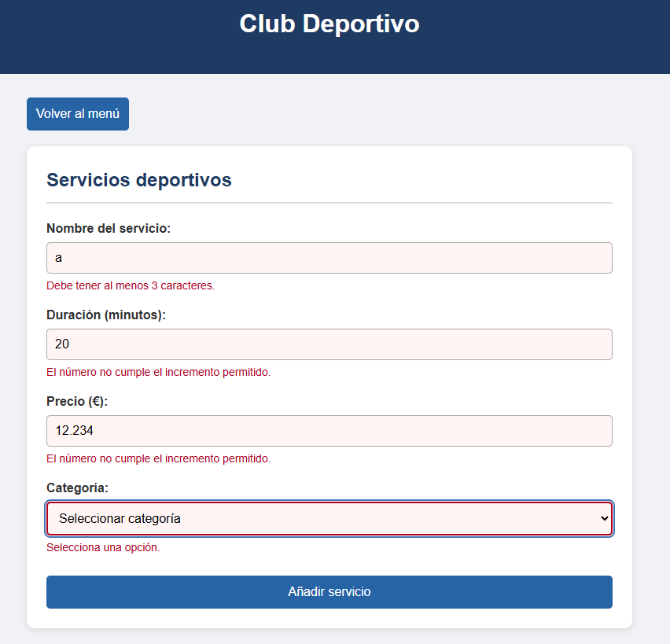

# Pruebas - Club Deportivo (Parte 1)

## 1. Ejecución

Para abrir la aplicación hay que ejecutar `index.html` con Live Server desde Visual Studio Code.

Desde el menú principal podemos acceder a los cinco formularios.

## 2. Pruebas de validación

### Socios

| Datos introducidos | Resultado esperado | Resultado obtenido |
|---|---|---|
| Campos vacíos o solo espacios | Mostrar errores | Correcto |
| Nombre de 3, 4, 50 y 51 caracteres | Aceptar solo entre 4 y 50 | Correcto |
| Usuario de 4, 5, 20 y 21 caracteres | Aceptar solo entre 5 y 20 | Correcto |
| Edad vacía, 17, 18, 18.5 y 101 | Aceptar únicamente 18 | Correcto |
| Correo incorrecto | Mostrar error | Correcto |
| Contraseña de 7, 8, 16 y 17 caracteres | Aceptar solo entre 8 y 16 | Correcto |
| Contraseñas diferentes | Mostrar error | Correcto |
| Modalidad sin seleccionar | Mostrar error | Correcto |
| Teléfono vacío | Mostrar error | Correcto |
| Condiciones sin marcar | Mostrar error | Correcto |

### Servicios

| Datos introducidos | Resultado esperado | Resultado obtenido |
|---|---|---|
| Nombre vacío, con espacios o fuera de los límites | Mostrar error | Correcto |
| Duración: 14, 15, 20 y 30 | Aceptar 15 y 30 | Correcto |
| Precio vacío, negativo, 0 y 12.555 | Aceptar únicamente 0 | Correcto |
| Categoría sin seleccionar | Mostrar error | Correcto |

### Testimonios

| Datos introducidos | Resultado esperado | Resultado obtenido |
|---|---|---|
| Autor vacío o fuera de los límites | Mostrar error | Correcto |
| Testimonio vacío o fuera de los límites | Mostrar error | Correcto |
| Escribir y borrar texto | Actualizar el contador | Correcto |
| Publicación sin marcar | Testimonio privado | Correcto |
| Publicación marcada | Publicación autorizada | Correcto |

### Noticias

| Datos introducidos | Resultado esperado | Resultado obtenido |
|---|---|---|
| Título vacío o fuera de los límites | Mostrar error | Correcto |
| Contenido vacío o fuera de los límites | Mostrar error | Correcto |
| Fecha de ayer | Rechazar | Correcto |
| Fecha de hoy | Rechazar | Correcto |
| Fecha de mañana | Aceptar | Correcto |

### Citas

| Datos introducidos | Resultado esperado | Resultado obtenido |
|---|---|---|
| Socio o servicio sin seleccionar | Mostrar error | Correcto |
| Fecha y hora pasadas | Rechazar | Correcto |
| Fecha y hora futuras | Aceptar | Correcto |
| Confirmación sin marcar | Mostrar error | Correcto |

### Imágenes de socios y noticias

| Tipo de archivo | Tamaño | Resultado esperado | Resultado obtenido |
|---|---|---|---|
| Sin archivo | — | Rechazar | Correcto |
| image/png | 781 bytes | Rechazar | Correcto |
| image/jpeg | 4.999.999 bytes | Aceptar | Correcto |
| image/jpeg | 5.000.000 bytes | Aceptar | Correcto |
| image/jpeg | 5.000.001 bytes | Rechazar | Correcto |

### Pruebas generales

| Prueba | Resultado esperado | Resultado obtenido |
|---|---|---|
| Varios campos incorrectos | Mostrar todos los errores | Correcto |
| Corregir un campo | Desaparece el error | Correcto |
| Pulsar Intro | Validar el formulario | Correcto |
| Cambiar la contraseña tras confirmarla | Volver a validar la confirmación | Correcto |
| Modificar datos después de un envío válido | Eliminar la confirmación anterior | Correcto |
| Enviar datos correctos | Mostrar confirmación simulada | Correcto |

## 3. Problemas encontrados

Al principio los formularios aparecían uno debajo de otro. Decidí crear un menú principal para que la aplicación estuviera mejor organizada.

Durante el cambio, algunos botones no mostraban su formulario correspondiente. Para solucionar este problema se revisó la relación entre los identificadores de las secciones y los botones del menú.

También añadí un botón para volver al menú, ya que todos los formularios están dentro del mismo HTML.

Para mejorar el diseño utilicé Font Awesome, añadiendo un icono y una pequeña descripción a cada apartado.

## 4. Validación en el servidor

Aunque los datos se validan mediante JavaScript, en una aplicación real habría que volver a comprobarlos en el servidor, ya que la validación del navegador se puede manipular.

También habría que comprobar el tipo, contenido y tamaño de las imágenes.

## 5. Capturas

Captura de un formulario con varios errores de validación.

