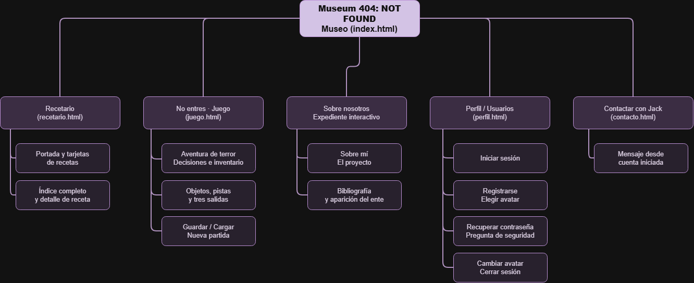

# 2. Diseño de interfaces

## Navegación y etiquetas
La portada index.html representa el museo. Recetario abre recetario.html; No entres · Juego abre juego.html; Visitante abre perfil.html y, tras acceder, muestra nombre y avatar. Contactar con Jack abre contacto.html. Sobre nosotros abre el expediente superpuesto; conocenos.html conserva la página independiente y aboutus.html redirige a ella.

El archivo DAWlloween_sitemap.drawio conserva el esquema editable original. La tabla anterior describe la navegación actual; los bocetos siguientes son referencias de diseño y pueden diferir de la implementación final.

## Wireframes originales
| Sección | Boceto |
|---|---|
| Museo | [Inicio](img/wireframe-inicio.png) |
| Libro | [Portada](img/wireframe-postres.png), [índice](img/wireframe-postres-1.png), [receta](img/wireframe-postres-2.png) |
| Juego | [Juego](img/wireframe-juego.png) |
| Sobre nosotros | [Expediente](img/wireframe-about.png) |
| Contacto | [Carta](img/wireframe-contactanos.png) |
| Perfil | [Inicio](img/wireframe-perfil-inicio.png), [registro](img/wireframe-perfil-registrar.png), [contraseña](img/wireframe-perfil-password.png) |

El juego actual utiliza botones; el campo de comandos y el ranking del boceto no están implementados. El perfil utiliza una momia con mano indicadora y formularios. El destinatario de contacto está fijado en PHP, sin selector editable.

## Guía de estilo implementada
| Color | Uso |
|---|---|
| #000000 | Negro de base y sombras. |
| #080606 / #120b0b | Fondos generales definidos en general.css. |
| #c1121f / #800d17 / #e63946 | Rojo principal, oscuro y brillante. |
| #e8e6df / #b7afa9 | Texto hueso y secundario general. |
| #6c242b | Borde general. |
| #f4dfb6 / #efca79 / #976527 | Texto, títulos y borde dorado del perfil. |
| #170907 / #f4e2bc / #bc914c | Fondo, texto y borde de contacto. |

Los colores adicionales del recetario, juego y expediente se definen en sus CSS. Las imágenes aportan matices rojizos, pergamino y metal envejecido que no equivalen a colores planos.

La fuente base de general.css es Arial/Helvetica/sans-serif. El perfil utiliza Georgia/serif y campos de formulario en Arial. El juego conserva su tipografía de máquina de escribir. Consultar los font-family y @font-face de cada CSS antes de modificar fuentes; los nombres propuestos en los primeros bocetos no garantizan que una fuente esté cargada.

## Componentes
- Vitrinas: marco, reflejos de vidrio, objeto y placa. Las fichas se abren en diálogo.
- Navegación: placas doradas para recetario, juego y regreso; controles de visitante y restablecimiento en cabecera.
- Libro: imágenes de portada y hojas; botones y contenido HTML independientes de las imágenes.
- Juego: imagen de habitación, texto, opciones e inventario; imagen modal de objeto y transición de puerta.
- Expediente: carpeta, polaroids y folio modal con botón de regreso.
- Perfil: fondo de momia, imagen de mano independiente, formularios y avatares en una lámina de diez retratos.
- Contacto: fondo Jack Skellington.png, formulario transparente sobre el pergamino, con correo tomado de la sesión.

## Estados y adaptación
Los controles deben mostrar foco de teclado; los formularios notifican error o éxito y bloquean envíos mientras procesan la petición. La mano responde al foco y al puntero. Los formularios largos permiten desplazamiento: ocultar campos para forzar una pantalla fija impediría registrarse. Reducir movimiento desactiva transiciones donde el código lo contempla. Verificar móvil, escritorio, contraste, zoom y accesibilidad mediante la lista de pruebas; no se afirma una auditoría WCAG completa.
