# 2. Diseño de Interfaces Web

## 2.1. Sitemap

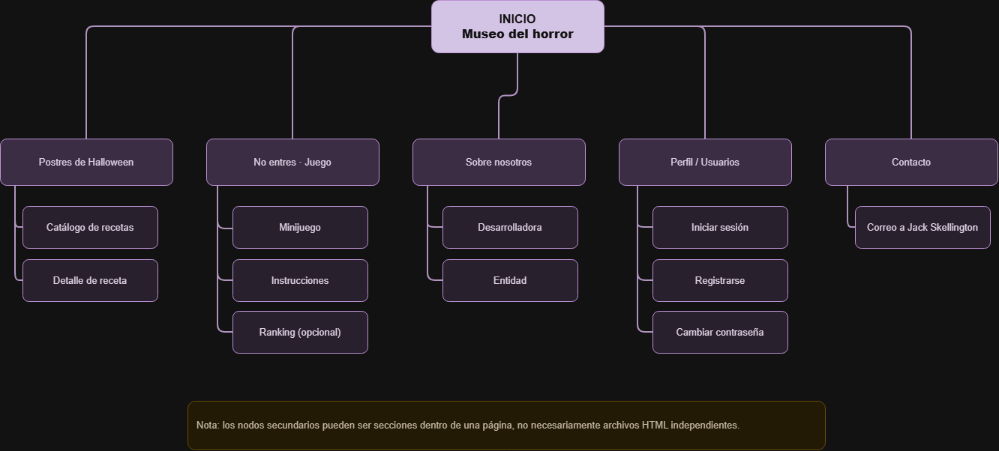

## 2.2. Labelling

El labelling define las etiquetas utilizadas para identificar las secciones y funcionalidades de la página web.

Se ha optado por utilizar nombres breves, comprensibles y relacionados con su contenido, manteniendo la temática de Halloween sin dificultar la navegación.

### 2.2.1. Navegación principal

| Etiqueta          | Ubicación                   | Descripción                                                     |
| ----------------- | --------------------------- | --------------------------------------------------------------- |
| Inicio            | Menú principal              | Acceso al museo del horror, que constituye la página principal. |
| Postres           | Menú principal              | Catálogo de recetas temáticas de Halloween.                     |
| No entres · Juego | Menú principal              | Acceso al minijuego de terror.                                  |
| Sobre nosotros    | Menú principal              | Presentación de la desarrolladora y la entidad ficticia.        |
| Contacto          | Menú principal              | Formulario para enviar mensajes a Jack Skellington.             |
| Perfil            | Cabecera (icono de usuario) | Acceso a las funcionalidades relacionadas con la cuenta.        |

### 2.2.2. Navegación secundaria

| Etiqueta           | Ubicación | Descripción                                                       |
| ------------------ | --------- | ----------------------------------------------------------------- |
| Iniciar sesión     | Perfil    | Acceso a una cuenta existente.                                    |
| Registrarse        | Perfil    | Creación de una cuenta de usuario.                                |
| Cambiar contraseña | Perfil    | Modificación de la contraseña mediante una pregunta de seguridad. |
| Detalle de receta  | Postres   | Consulta de ingredientes y preparación de una receta.             |
| Instrucciones      | Juego     | Explicación de las reglas y controles del minijuego.              |

### 2.2.3. Criterios de etiquetado

Las etiquetas se han seleccionado siguiendo tres criterios:

- **Claridad:** los nombres deben permitir identificar el contenido de cada sección.
- **Consistencia:** las mismas secciones mantendrán sus nombres en toda la web.
- **Usabilidad:** se evitarán etiquetas ambiguas que puedan dificultar la navegación.

En el caso de «No entres · Juego», se combina una expresión relacionada con la temática de terror con la palabra «Juego», para que el visitante pueda identificar su función.

## 2.3. Wireframes Lo-Fi

### 2.3.1. Página principal — Museo del horror

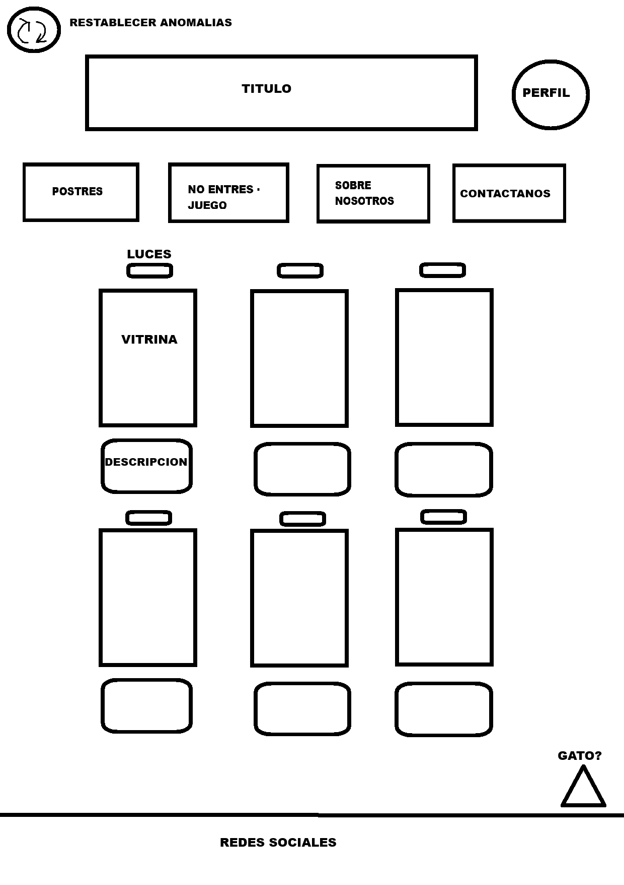

### 2.3.2. Postres de Halloween — Libro de recetas

La sección de postres se presenta como un libro de recetas interactivo.

Al seleccionar la portada, el usuario accede al índice, donde puede elegir directamente una receta o avanzar manualmente utilizando las flechas de navegación.

Cada receta incluye una imagen o vídeo, los ingredientes y las instrucciones de preparación.

**Portada del libro**

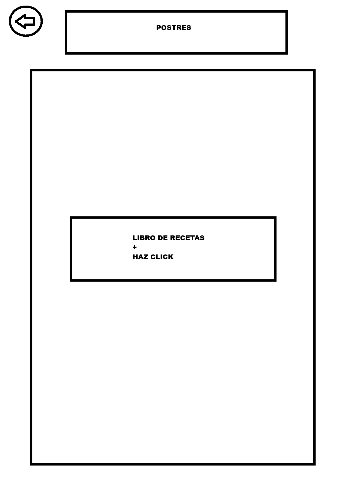

**Índice de recetas**

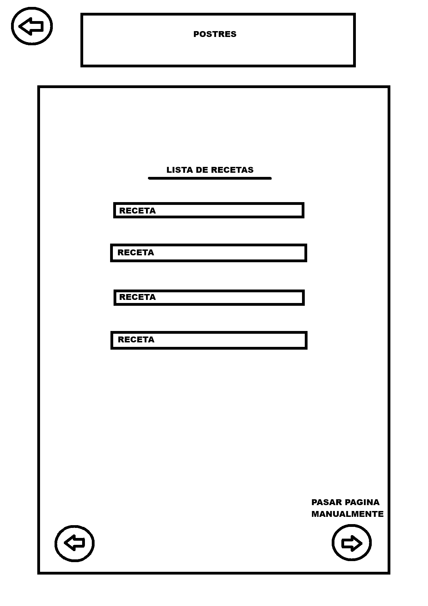

**Página de receta**

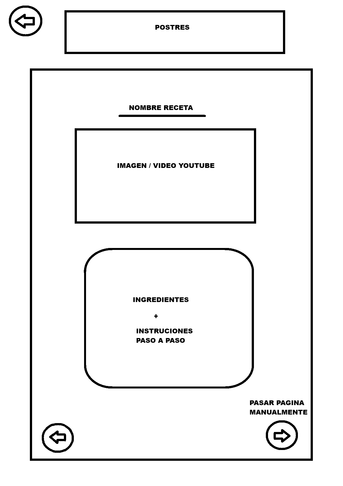

### 2.3.3. No entres — Juego

El minijuego consiste en una aventura de terror interactiva en la que el usuario deberá explorar diferentes habitaciones, recoger objetos y resolver pequeños acertijos mediante comandos escritos.

La interfaz contará con un área principal para desarrollar la partida y un apartado de instrucciones que ayudará al jugador a comprender su funcionamiento.

Se ha reservado un espacio lateral para mostrar un ranking con los mejores tiempos. Esta funcionalidad será opcional y dependerá del tiempo disponible para su implementación.

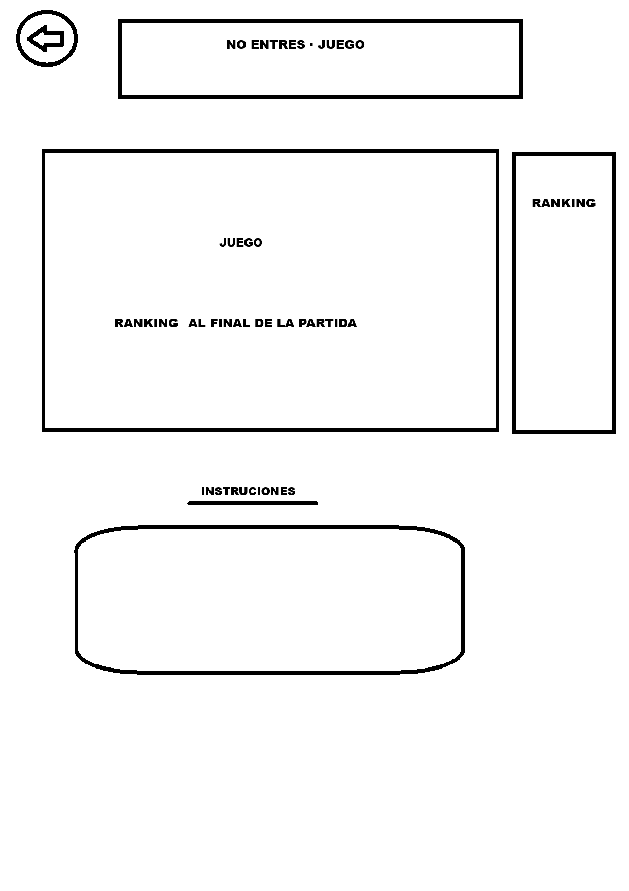

### 2.3.4. Sobre nosotros

Esta sección presenta a la desarrolladora y a una entidad ficticia que acompaña al proyecto.

Se incluyen dos imágenes de perfil, una descripción general de DAWlloween y un apartado de bibliografía para recoger las fuentes y recursos utilizados.

La imagen de la entidad contará con una interacción de terror: al pulsarla, se mostrará un screamer.

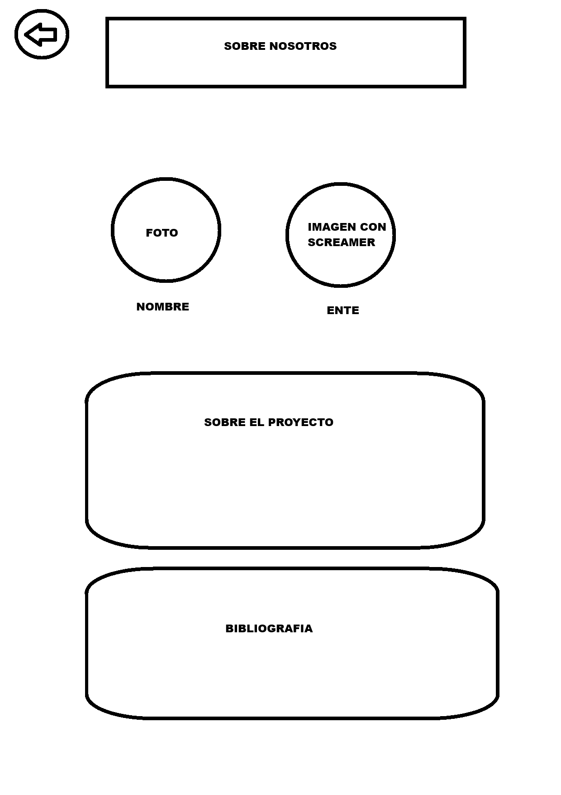

### 2.3.5. Contacto — Carta a Jack Skellington

La sección de contacto permite al visitante enviar un mensaje mediante un formulario que solicita su nombre, correo electrónico y mensaje.

El campo de destinatario presenta un comportamiento anómalo intencionado: aunque el usuario intente seleccionar otra persona, siempre se establecerá Jack Skellington como destinatario.

El formulario se procesará mediante PHP utilizando la función `mail()`.

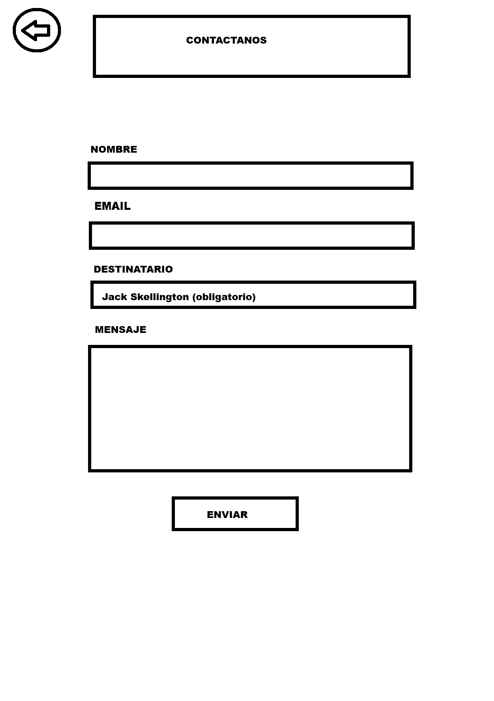

### 2.3.6. Perfil

La sección de Perfil permite a los usuarios iniciar sesión, registrarse y cambiar su contraseña.

El acceso se realiza mediante un icono situado en la parte superior derecha de la página principal. Al pulsarlo, se despliega un menú cuyas opciones cambian dependiendo de si el usuario ha iniciado sesión.

#### Menú sin iniciar sesión

Cuando el visitante no ha iniciado sesión, el menú muestra las opciones de iniciar sesión, registrarse y recuperar la contraseña.

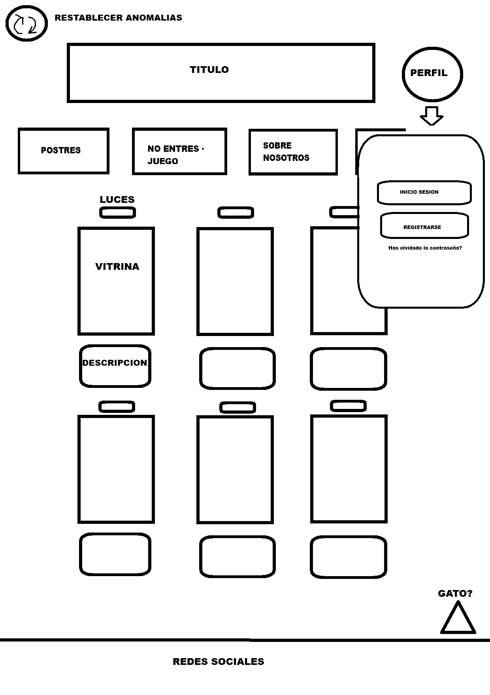

#### Menú con sesión iniciada

Cuando el usuario ha iniciado sesión, el menú muestra su nombre de usuario y las opciones de cambiar contraseña y cerrar sesión.

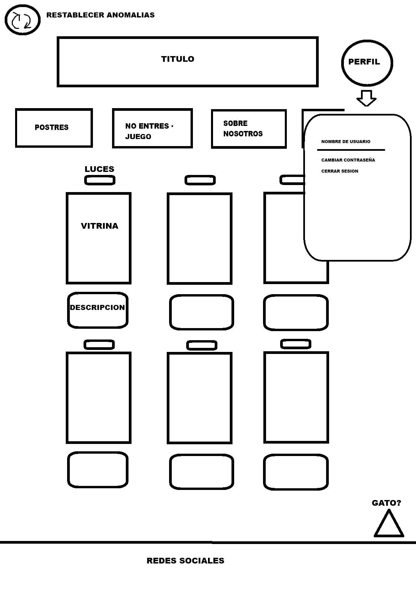

#### Inicio de sesión

Formulario que permite acceder a una cuenta existente mediante el nombre de usuario y la contraseña.

También incluye un enlace para recuperar la contraseña.

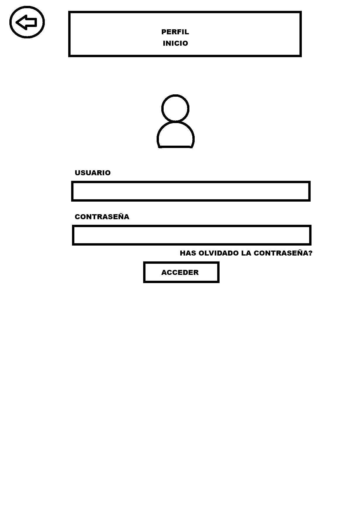

#### Registro de usuario

Formulario que permite crear una cuenta introduciendo el nombre de usuario, la contraseña, el correo electrónico y una pregunta de seguridad con su correspondiente respuesta.

El campo Perfil no aparece en el formulario, ya que se asigna automáticamente con el valor `user`.

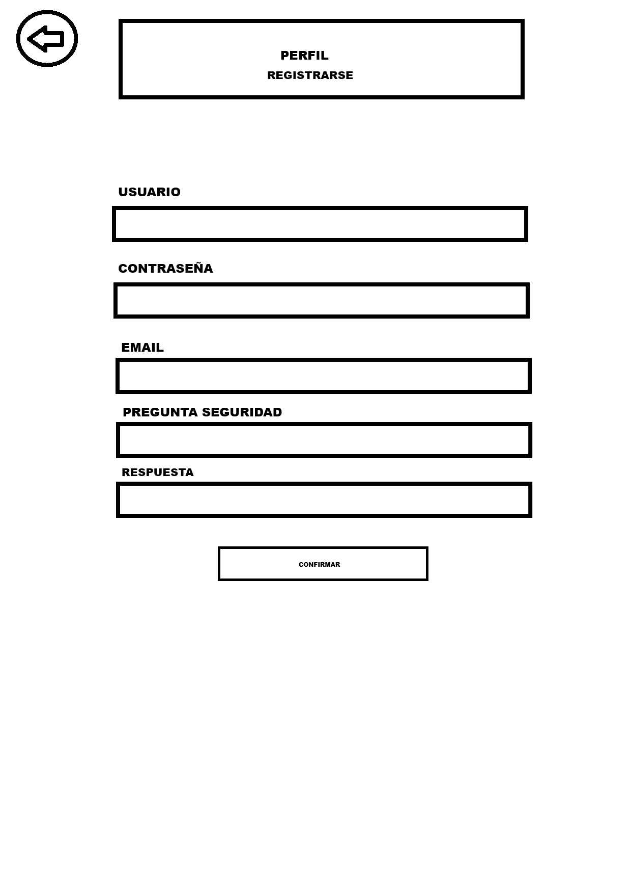

#### Cambio de contraseña

Formulario que permite cambiar la contraseña mediante la pregunta de seguridad y su respuesta.

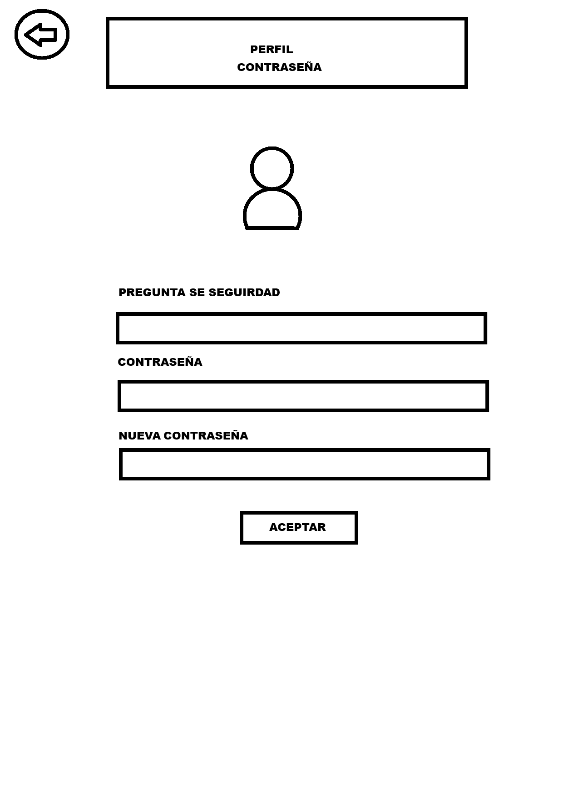

## 2.4. Guía de estilo

### 2.4.1. Paleta de colores

La paleta de colores de DAWlloween está inspirada en la estética
de FAITH: The Unholy Trinity, utilizando tonos oscuros y colores
intensos para transmitir una atmósfera de terror.

Aunque se mantiene una identidad visual común, cada sección
utilizará diferentes combinaciones de colores según su temática.

| Color        | Código HEX | Uso principal                                 |
| ------------ | ---------- | --------------------------------------------- |
| Negro        | #000000    | Fondos oscuros y contrastes.                  |
| Rojo         | #C1121F    | Advertencias y elementos de terror.           |
| Morado       | #8B4BC0    | Brujería y elementos paranormales.            |
| Rosa         | #E879B9    | Detalles relacionados con la entidad.         |
| Blanco hueso | #E8E6DF    | Textos y elementos que requieren legibilidad. |
| Azul         | #183A9E    | Elementos secundarios y efectos puntuales.    |

#### 2.4.2. Aplicación de colores por sección

| Sección                     | Colores predominantes            | Estética                                                    |
| --------------------------- | -------------------------------- | ----------------------------------------------------------- |
| Inicio — Museo del horror   | Negro, blanco hueso y rojo       | Museo abandonado con una ambientación oscura y deteriorada. |
| Postres                     | Morado, negro y blanco hueso     | Libro de recetas de brujas.                                 |
| No entres — Juego           | Negro, rojo, morado, rosa y azul | Terror retro y pixel art inspirado en FAITH.                |
| Sobre nosotros              | Negro, morado y rosa             | Estética paranormal inspirada en FAITH.                     |
| Contacto                    | Por determinar                   | Ambientación de Halloween con libertad estética.            |
| Inicio de sesión y registro | Negro, blanco hueso y rojo       | Formularios sencillos y legibles.                           |

### 2.4.2. Tipografías

Las tipografías de DAWlloween se han seleccionado para reforzar
la ambientación de terror y mantener una buena legibilidad.

Se utilizarán diferentes fuentes según la temática de cada
sección, manteniendo una identidad visual coherente en toda
la página web.

| Tipografía         | Aplicación                                            | Justificación                                                                                          |
| ------------------ | ----------------------------------------------------- | ------------------------------------------------------------------------------------------------------ |
| **Creepster**      | Título principal de DAWlloween y títulos de terror.   | Su estética de Halloween ayuda a transmitir una atmósfera inquietante.                                 |
| **Special Elite**  | Menú de navegación y botones principales.             | Su apariencia de máquina de escribir antigua encaja con la ambientación de una casa abandonada.        |
| **Merriweather**   | Textos generales, recetas y formularios.              | Facilita la lectura y mantiene una apariencia clásica.                                                 |
| **Cinzel**         | Nombres de los objetos malditos y títulos de recetas. | Inspirada en inscripciones clásicas, aporta elegancia y solemnidad.                                    |
| **EB Garamond**    | Descripciones de las placas del museo.                | Su estilo tradicional recuerda a los textos de las exposiciones antiguas.                              |
| **Press Start 2P** | Títulos y mensajes destacados del minijuego.          | Su estética pixelada está inspirada en los videojuegos retro, especialmente FAITH: The Unholy Trinity. |
| **VT323**          | Narración y comandos del minijuego.                   | Mantiene una estética retro y facilita la lectura de textos más extensos.                              |

#### Aplicación de tipografías por sección

| Sección                         | Tipografías principales                         |
| ------------------------------- | ----------------------------------------------- |
| **Inicio — Museo del horror**   | Creepster, Special Elite, Cinzel y EB Garamond. |
| **Postres**                     | Cinzel y Merriweather.                          |
| **No entres — Juego**           | Press Start 2P y VT323.                         |
| **Sobre nosotros**              | Creepster y Merriweather.                       |
| **Contacto**                    | Special Elite y Merriweather.                   |
| **Inicio de sesión y registro** | Special Elite y Merriweather.                   |

Las tipografías decorativas se utilizarán principalmente
en títulos y elementos destacados, mientras que los textos
extensos emplearán fuentes que faciliten la lectura.

### 2.4.3. Componentes visuales

Los componentes visuales de DAWlloween estarán adaptados a la
temática de terror de cada sección, manteniendo una navegación
intuitiva y una apariencia coherente.

| Componente              | Diseño y características                                                                                                                                           |
| ----------------------- | ------------------------------------------------------------------------------------------------------------------------------------------------------------------ |
| **Menú de navegación**  | Situado en la parte superior de la página. Utilizará la tipografía Special Elite y colores que contrasten con el fondo.                                            |
| **Botones**             | Predominarán los tonos oscuros con textos claros y detalles en rojo o morado. Algunos botones tendrán efectos interactivos relacionados con la temática de terror. |
| **Vitrinas del museo**  | Contendrán los objetos malditos, acompañados de una placa identificativa con el nombre y una breve descripción.                                                    |
| **Placas del museo**    | Inspiradas en las placas de museos antiguos. Utilizarán Cinzel para los nombres de los objetos y EB Garamond para las descripciones.                               |
| **Libro de recetas**    | Presentará las recetas mediante páginas con títulos, imágenes, ingredientes e instrucciones. Incorporará controles para navegar entre ellas.                       |
| **Panel del minijuego** | Interfaz de aventura de texto inspirada en los videojuegos retro, con fondo oscuro, tipografía pixelada y un campo para introducir comandos.                       |
| **Formularios**         | Campos de entrada claramente identificados, textos legibles y botones diferenciados para enviar la información.                                                    |
| **Iconos**              | Iconos sencillos y reconocibles para el acceso de usuario, la navegación y otras funciones.                                                                        |
| **Pie de página**       | Contendrá información complementaria y enlaces a redes sociales, manteniendo la estética general del sitio.                                                        |

#### Estados e interacciones

Los elementos interactivos tendrán diferentes estados visuales
para que el usuario pueda reconocer cuándo puede utilizarlos.

- **Estado normal:** apariencia habitual del componente.
- **Hover:** cambio visual al situar el cursor sobre un elemento.
- **Activo:** indica que un botón ha sido pulsado o que una sección está seleccionada.
- **Focus:** permite identificar el elemento seleccionado mediante el teclado.
- **Error:** mensajes visibles cuando se introducen datos incorrectos en un formulario.
- **Éxito:** confirmación visual cuando una acción se realiza correctamente.

Algunas interacciones podrán alterar temporalmente el comportamiento
de los componentes, especialmente en la página principal del museo.
Estas anomalías estarán controladas para no impedir la navegación.

### 2.4.4. Estética general

DAWlloween tendrá una estética inspirada en el terror clásico,
las casas abandonadas y los videojuegos de terror retro.

Cada sección contará con una ambientación propia, manteniendo
elementos visuales comunes para dar coherencia al sitio web.

| Sección                       | Ambientación                                                                                                                 |
| ----------------------------- | ---------------------------------------------------------------------------------------------------------------------------- |
| **Inicio — Museo del horror** | Museo de objetos malditos situado en un edificio abandonado. Fondos deteriorados, iluminación tenue y detalles inquietantes. |
| **Postres**                   | Libro de recetas de brujas, con apariencia de grimorio antiguo y elementos relacionados con la magia.                        |
| **No entres — Juego**         | Aventura de texto con estética pixel art, inspirada en FAITH: The Unholy Trinity y los videojuegos clásicos como Zork.       |
| **Sobre nosotros**            | Ambientación paranormal con elementos visuales inspirados en FAITH y una entidad misteriosa.                                 |
| **Contacto**                  | Estética de Halloween adaptada al formulario de contacto con Jack Skellington.                                               |
| **Acceso y registro**         | Diseño oscuro y sencillo, priorizando la claridad de los formularios.                                                        |

La iluminación, las texturas y los efectos visuales ayudarán
a crear una atmósfera de terror sin dificultar la lectura
ni la navegación.

Se priorizará la usabilidad, evitando que los efectos
decorativos interfieran con las funciones principales.

🟨 Amarillo antiguo #D6AD43 Objetos importantes y pequeños detalles. ESTE COLOR PUEDE SER OPCINAL
